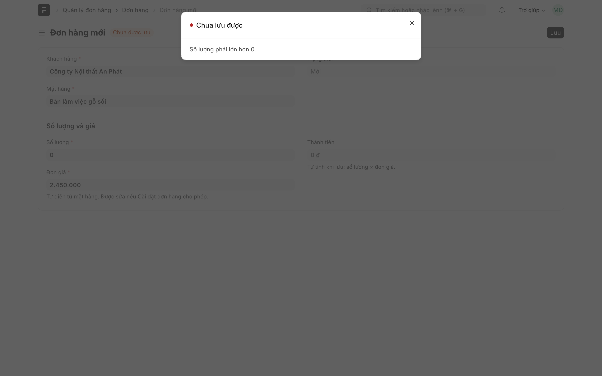
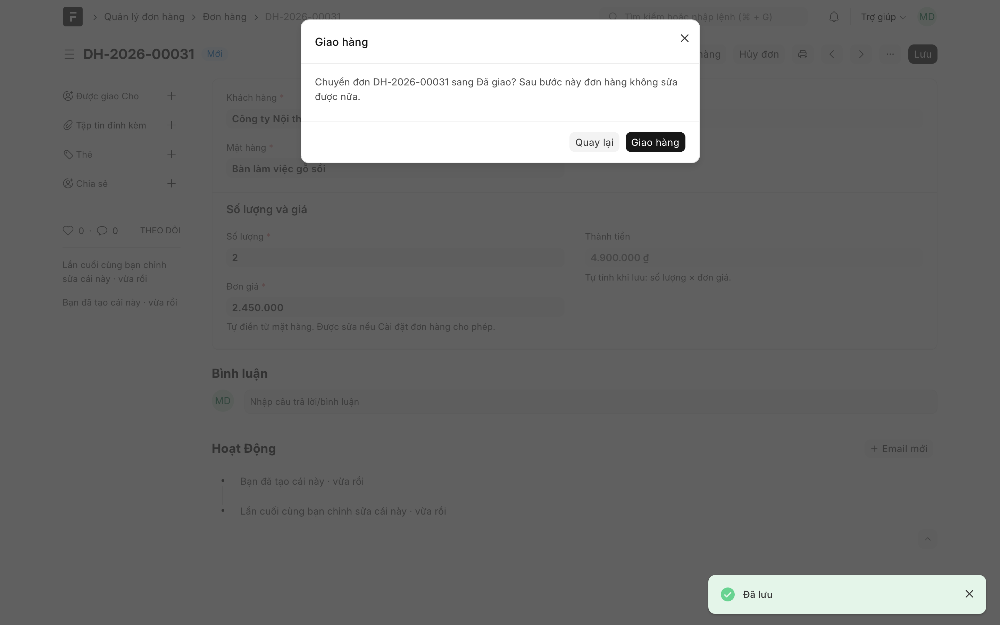
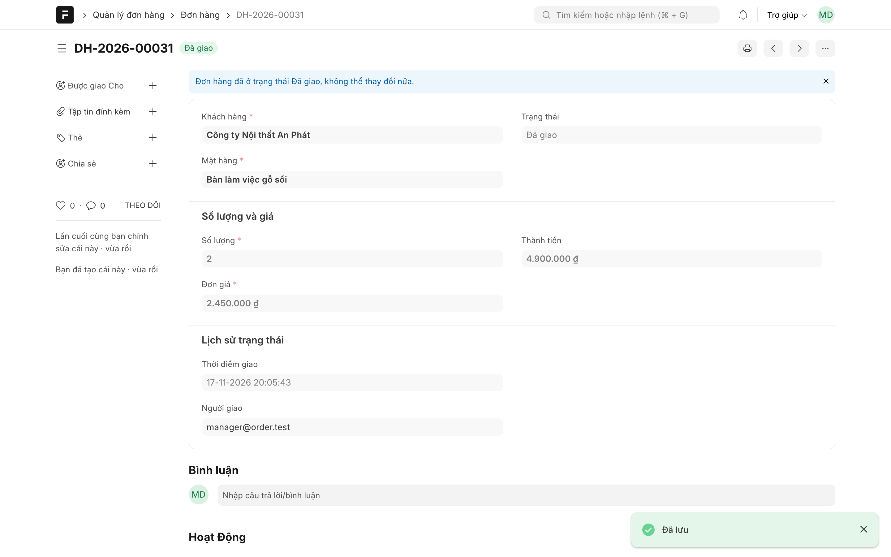
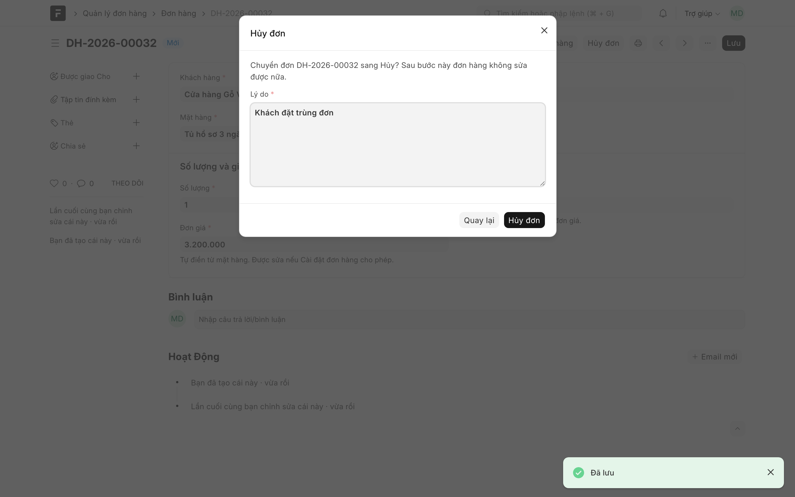
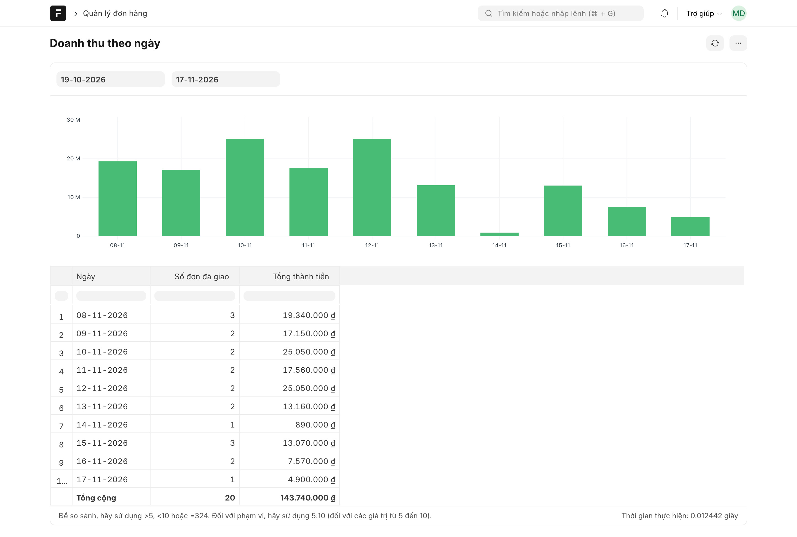
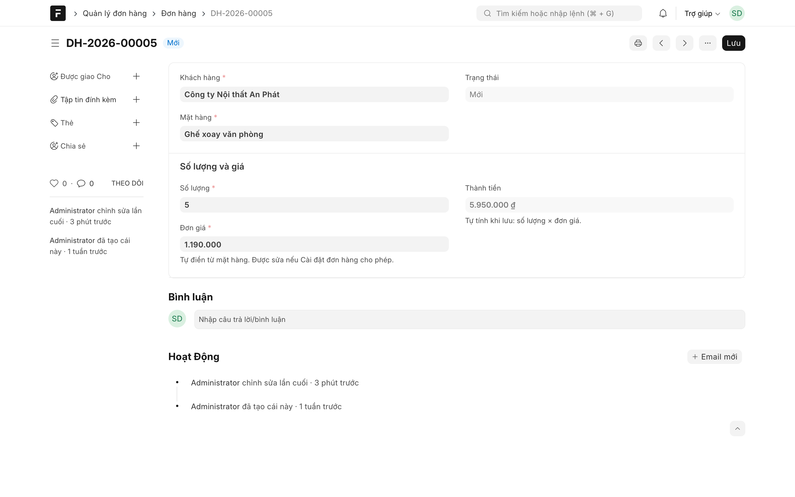

# Order Management

App Frappe quản lý đơn hàng cho bài test ERP/CRM: tạo đơn, giao hoặc hủy đơn, xem doanh thu theo ngày.

[](https://github.com/ItsNLVu/order_management/actions/workflows/ci.yml)


Video 50 giây: [docs/demo.mp4](docs/demo.mp4)

## Cài đặt

Cần một bench Frappe v15.

```bash
bench get-app https://github.com/ItsNLVu/order_management
bench --site <site> install-app order_management
```

Dữ liệu mẫu: 4 khách hàng, 4 mặt hàng, 30 đơn trong 10 ngày gần nhất. Lệnh này đổi múi giờ, tiền tệ và ngôn ngữ mặc định của site sang Việt Nam, nên chỉ chạy trên site thử.

```bash
bench --site <site> execute order_management.demo.create_demo_data
```

| Tài khoản | Mật khẩu | Quyền |
|---|---|---|
| `sales@order.test` | `Demo@2026` | Tạo, sửa, xóa đơn Mới |
| `manager@order.test` | `Demo@2026` | Thêm: giao, hủy đơn, xem báo cáo, sửa danh mục và cài đặt |

Nếu Administrator đang dùng tiếng Anh, đổi ngôn ngữ trong My Settings.

## Cách làm từng yêu cầu

| Yêu cầu | Cách làm |
|---|---|
| Thành tiền do server tính; số lượng, đơn giá > 0 | Mỗi lần lưu, `validate` tính lại thành tiền và bỏ qua số client gửi. Đơn giá được làm tròn theo tiền trước khi kiểm tra. |
| Mới → Đã giao hoặc Hủy; đơn đã giao, đã hủy không sửa được | Các bước chuyển nằm trong bảng `TRANSITIONS`. Đơn ở trạng thái cuối bị chặn sửa, đổi trạng thái và xóa. |
| Báo cáo doanh thu theo ngày | Script Report `Daily Revenue`: chỉ đơn Đã giao, nhóm theo ngày tạo, cộng trong SQL. |
| Giao diện | Desk có sẵn, thêm nút Giao hàng, Hủy đơn có hộp thoại xác nhận và biểu đồ trong báo cáo. |

Luật nằm trong controller, nên form, REST API và Data Import đều bị kiểm tra như nhau.

## Code chính

- `services/status_machine.py`: bảng chuyển trạng thái, vai trò được làm, trường ghi thời điểm và người làm.
- `services/pricing.py`, `services/validators.py`: tính tiền và các kiểm tra dùng lại.
- `doctype/customer_order/customer_order.py`: controller, gọi các service khi tạo, lưu, xóa.
- `api.py`: `apply_action` cho nút giao, hủy; khóa dòng trước khi đổi.
- `report/daily_revenue/`: báo cáo.

Thêm một trạng thái (ví dụ Đang giao) chỉ phải sửa bảng `TRANSITIONS`, danh sách trạng thái trong JSON và file dịch.

## Giả định

- Khách hàng và mặt hàng là danh mục riêng của app, không cần ERPNext.
- Không dùng Submit/Cancel của Frappe: Frappe không cho hủy bản nháp, và đơn đã hủy còn Amend được. Không dùng Workflow để luật nằm trong code và có test.
- Số lượng là số nguyên, mặc định 1. Đơn giá tự điền khi chọn mặt hàng và sửa được; tắt quyền sửa trong Cài đặt đơn hàng thì luôn lấy giá mặt hàng.
- Hủy đơn phải ghi lý do (tắt được trong Cài đặt đơn hàng). Server ghi thời điểm và người giao, hủy.
- Chỉ xóa được đơn Mới.
- Ngày tạo là trường `creation`, người dùng không sửa được. Đơn tạo hôm qua, giao hôm nay thì tính vào hôm qua. Site cần múi giờ `Asia/Ho_Chi_Minh`.
- Báo cáo bỏ qua ngày không có đơn; mặc định 30 ngày gần nhất, tính cả hôm nay.
- Có index `(status, creation)` cho báo cáo. Hai người cùng giao hoặc hủy một đơn thì người sau bị chặn.

## Test

```bash
bench --site <site> set-config allow_tests true
bench --site <site> run-tests --app order_management
```

51 test. Mỗi lần push, CI cài app từ repo này lên một bench v15 trống và chạy toàn bộ test.

## Chưa làm

- Mỗi đơn một mặt hàng, đúng như đề.
- Chưa thử trên Frappe v16.

## Ảnh chụp màn hình

| | |
|---|---|
|  Workspace |  Danh sách đơn |
|  Số lượng 0 bị từ chối |  Xác nhận trước khi giao |
|  Đơn đã giao bị khóa |  Hủy đơn phải có lý do |
|  Doanh thu theo ngày |  Nhân viên không có nút giao, hủy |

Các ảnh khác nằm trong `docs/screenshots/`.

## Giấy phép

MIT
