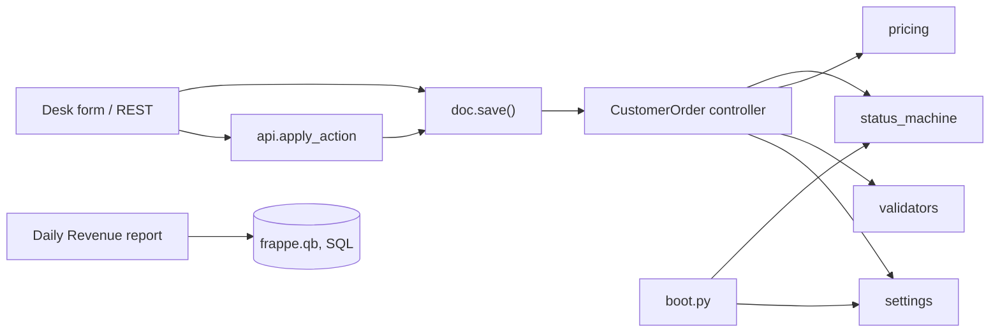
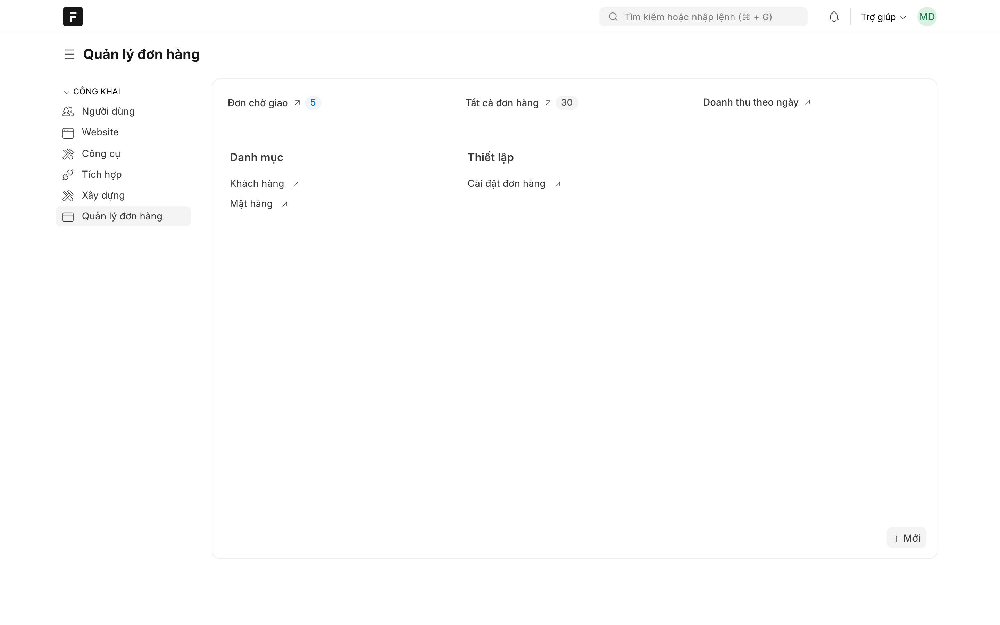
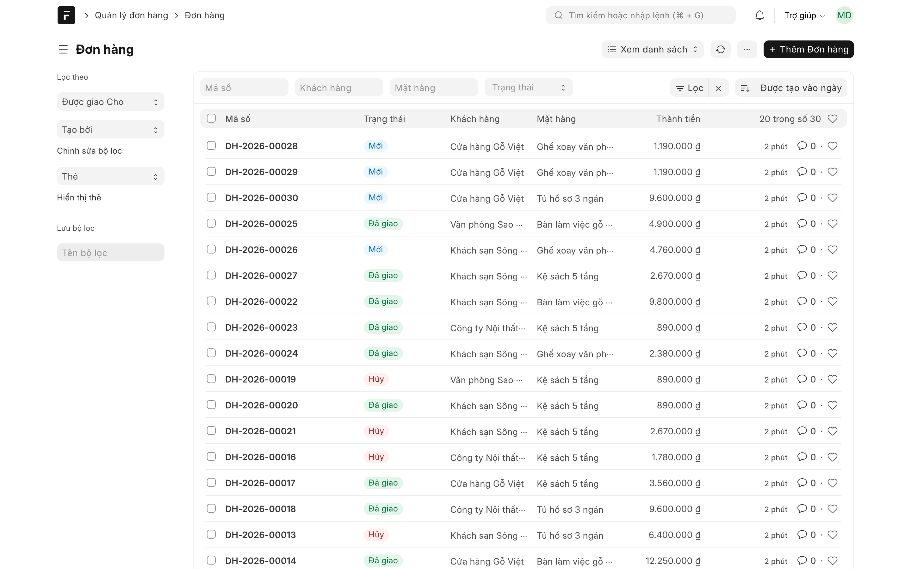
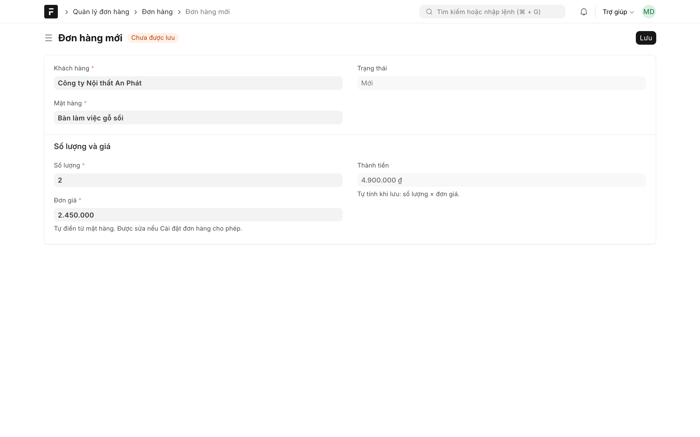
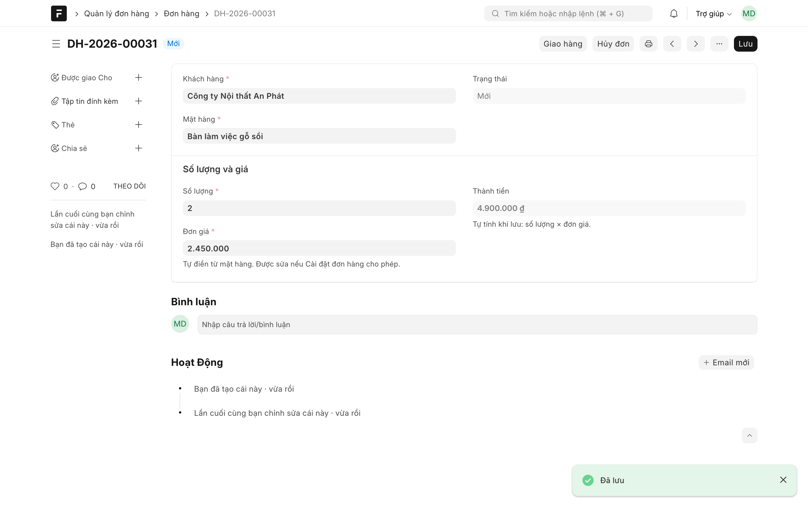
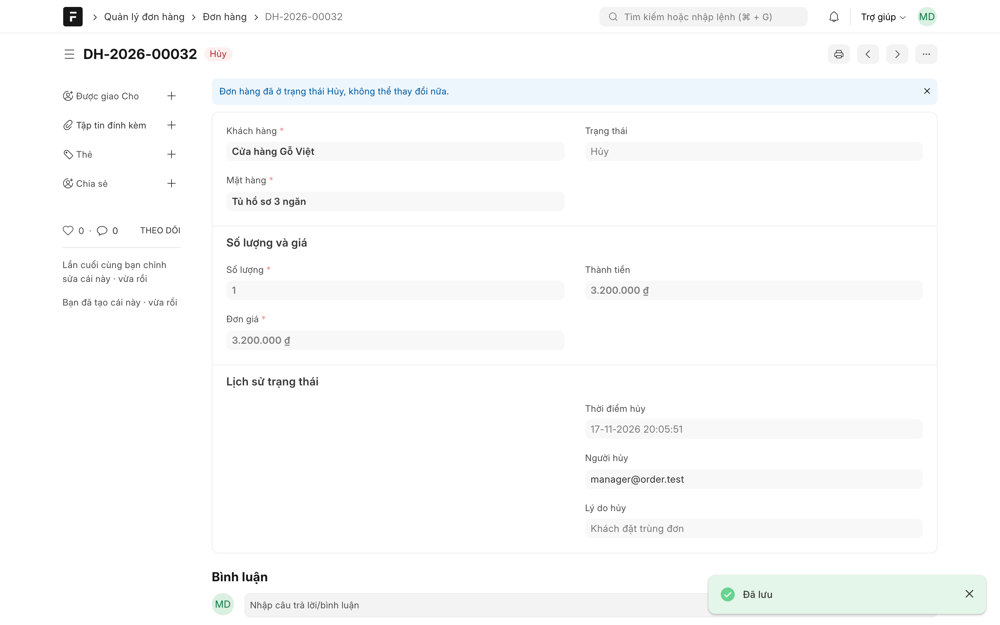
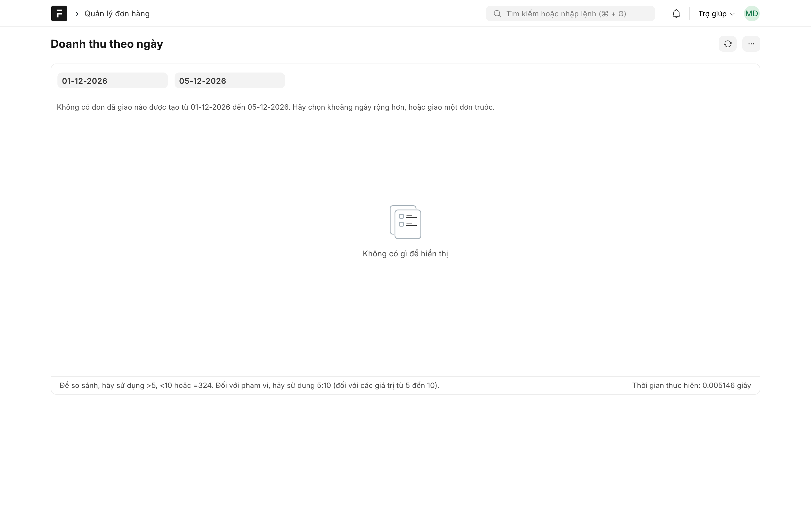
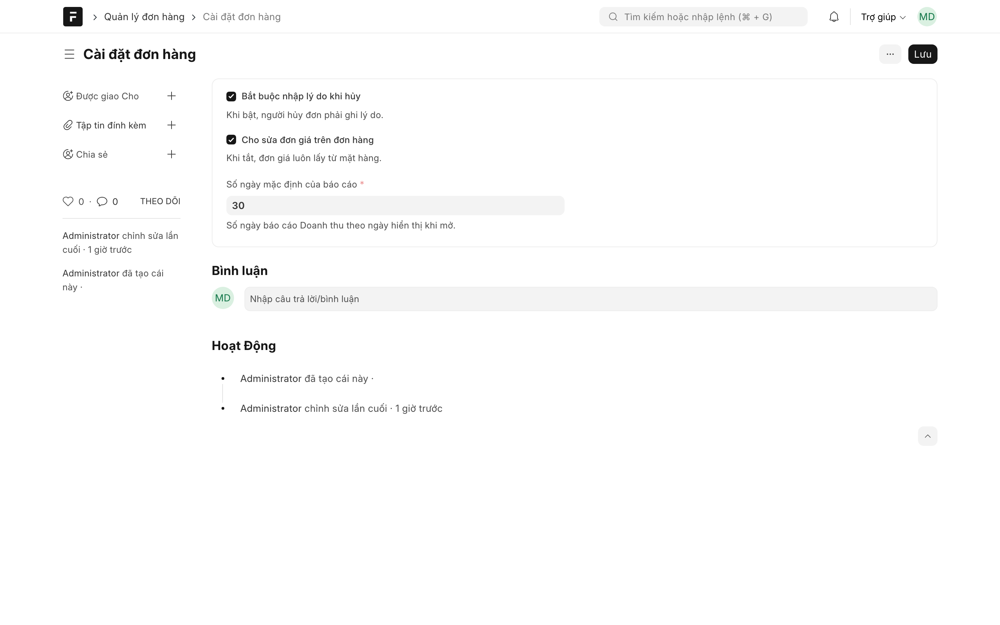
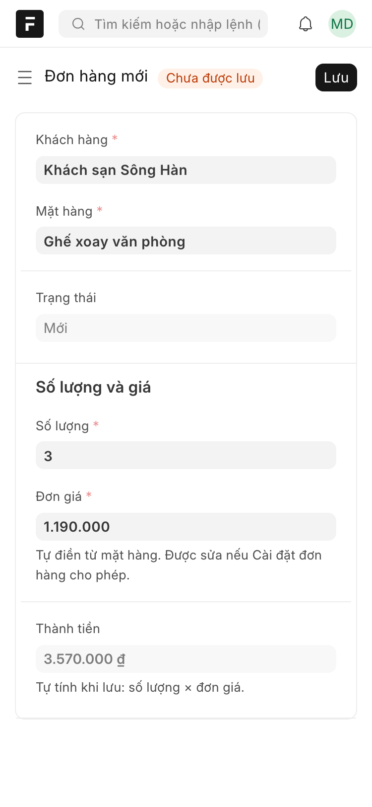

# Order Management

App Frappe nhỏ để quản lý đơn hàng: tạo đơn, giao hoặc hủy đơn theo luật trạng thái, và xem doanh thu đơn đã giao theo từng ngày. Bài test vị trí Lập trình viên ERP/CRM.

[](https://github.com/ItsNLVu/order_management/actions/workflows/ci.yml)


Video đầy đủ (50 giây): [docs/demo.mp4](docs/demo.mp4). Ảnh từng màn hình ở [cuối trang](#ảnh-chụp-màn-hình).

## Cài đặt

Cần một bench Frappe v15 (Python 3.10 trở lên, đã chạy với 3.11; MariaDB 10.6 trở lên; Redis; Node 18).

```bash
bench get-app https://github.com/ItsNLVu/order_management
bench --site <site> install-app order_management
```

Khi cài, app tự tạo 2 vai trò và ghi giá trị mặc định cho Cài đặt đơn hàng.

Dữ liệu mẫu (không bắt buộc):

```bash
bench --site <site> execute order_management.demo.create_demo_data
```

Lệnh này tạo 4 khách hàng, 4 mặt hàng, 30 đơn trải trong 10 ngày gần nhất và 2 tài khoản demo. Nó cũng đặt múi giờ `Asia/Ho_Chi_Minh`, tiền VND và định dạng số `#.###` trong System Settings, nên chỉ nên chạy trên site thử.

| Tài khoản | Mật khẩu | Vai trò | Làm được |
|---|---|---|---|
| `sales@order.test` | `Demo@2026` | Nhân viên bán hàng | Tạo, sửa, xóa đơn Mới; xem khách hàng và mặt hàng |
| `manager@order.test` | `Demo@2026` | Quản lý bán hàng | Như trên, cộng giao đơn, hủy đơn, xem báo cáo, sửa danh mục và cài đặt |

Chữ trên giao diện và thông báo lỗi hiện theo ngôn ngữ của người dùng. Lệnh dữ liệu mẫu đặt tiếng Việt làm mặc định và cho 2 tài khoản demo; tài khoản đã chọn tiếng Anh (ví dụ Administrator sau setup wizard) sẽ thấy tiếng Anh, đổi trong My Settings.

## Đề bài và chỗ xử lý trong code

| Yêu cầu | Xử lý | Test |
|---|---|---|
| Đơn hàng: khách hàng, mặt hàng, số lượng, đơn giá, thành tiền | DocType `Customer Order`; khách hàng và mặt hàng là danh mục riêng (`Order Customer`, `Order Item`) | `test_customer_order.py` |
| Thành tiền = số lượng × đơn giá, server tính; số lượng và đơn giá > 0 | `services/pricing.py`, `services/validators.py`, gọi trong `CustomerOrder.validate` | tiền gửi từ client bị bỏ qua; 0, số âm, số lẻ bị từ chối |
| Mới → Đã giao hoặc Hủy; đơn đã giao/hủy không sửa, không đổi trạng thái | Bảng `TRANSITIONS` trong `services/status_machine.py`; controller chặn mọi thay đổi trên đơn ở trạng thái cuối | mọi cặp trạng thái; sửa, đổi trạng thái, xóa đơn đã khóa |
| Báo cáo doanh thu theo ngày: số đơn, tổng tiền, chỉ đơn Đã giao, theo ngày tạo | Script Report `Daily Revenue`, gộp trong SQL | biên ngày 23:59:59 và 00:00, bỏ đơn Mới và Hủy, khoảng ngày rỗng |
| Giao diện đủ dùng | Frappe Desk, thêm nút trạng thái, hộp thoại xác nhận, biểu đồ, workspace | `test_metadata_sync.py` canh danh sách trạng thái và bản dịch |

Luật nằm ở server, nên form, REST API (`/api/resource/Customer Order`), import dữ liệu và endpoint `order_management.api.apply_action` đều bị kiểm tra như nhau. Form chỉ hỏi server "đơn này người dùng được làm gì" rồi vẽ nút.

## Kiến trúc



| Phần | Việc | Không làm |
|---|---|---|
| `constants.py` | Mã trạng thái, hành động, vai trò, tên DocType (Enum) | Không chứa chữ hiển thị |
| `services/status_machine.py` | Bảng chuyển trạng thái: từ đâu, sang đâu, vai trò nào, ghi thời điểm và người vào trường nào, có cần lý do không | Không đọc hay ghi database |
| `services/pricing.py` | Tính thành tiền | Không biết DocType |
| `services/validators.py` | Kiểm tra dùng lại: số dương, số nguyên, danh mục còn dùng, trường không đổi | Không chứa luật riêng của đơn |
| `services/settings.py` | Đọc Cài đặt đơn hàng (có cache) | |
| `customer_order.py` | Gọi các service theo vòng đời của Frappe | Không tự viết luật |
| `api.py` | Một endpoint cho mọi hành động; khóa dòng trước khi đổi | Không lặp lại luật |
| `boot.py` | Gửi màu trạng thái và cài đặt xuống trình duyệt | |
| JS form và list | Vẽ nút từ danh sách server trả về, hộp thoại xác nhận | Không biết tên trạng thái hay vai trò |

Thêm một trạng thái (ví dụ "Đang giao") là thêm một giá trị Enum, một dòng trong `TRANSITIONS`, một option trong JSON và một dòng dịch. Nút, quyền và kiểm tra tự theo.

## Quyết định và giả định

- Không dùng Submit/Cancel (`docstatus`) của Frappe. Frappe không cho Cancel một bản nháp, và đơn đã Cancel có thể Amend thành đơn mới, nên không khớp luật Mới → Hủy của đề. App dùng trường trạng thái riêng.
- Không dùng Workflow của Frappe. Workflow lưu cấu hình trong database; luật ở đây nằm trong code để đọc và test được.
- Trạng thái lưu mã tiếng Anh (`New`, `Delivered`, `Cancelled`) và hiển thị tiếng Việt qua `translations/vi.csv`, giống cách ERPNext làm.
- Số lượng là số nguyên, mặc định 1 nếu không gửi. Đơn giá được làm tròn theo đơn vị tiền trước khi kiểm tra > 0, nên 0,1 đồng bị từ chối thay vì tạo đơn 0 đồng. Số vượt quá sức chứa của cột trong database bị từ chối bằng thông báo, không gây lỗi server. Trên form, chọn mặt hàng thì đơn giá tự điền và vẫn sửa được; gọi qua API thì gửi kèm đơn giá. Nếu tắt "Cho sửa đơn giá trên đơn hàng" trong Cài đặt đơn hàng, server luôn lấy giá của mặt hàng, kể cả khi lưu lại một đơn Mới. Đơn đã giao hoặc đã hủy giữ nguyên giá, đổi giá danh mục sau đó không ảnh hưởng.
- Không tạo đơn với khách hàng hoặc mặt hàng đã ngừng dùng. Đơn Mới tạo trước khi ngừng dùng vẫn giao được.
- Hủy đơn phải có lý do (tắt được trong Cài đặt đơn hàng). Server tự ghi thời điểm và người giao hoặc hủy.
- Chỉ xóa được đơn Mới. Xóa đơn đã giao sẽ làm sai báo cáo.
- Chỉ Quản lý bán hàng được giao, hủy, xem báo cáo, sửa khách hàng, mặt hàng và Cài đặt đơn hàng. Nhân viên bán hàng chỉ xem danh mục. Server kiểm tra vai trò, không chỉ ẩn nút; `test_permissions.py` kiểm tra cả ma trận quyền.
- Ghi lại đúng trạng thái hiện tại lên một đơn đã khóa không đổi gì nên không báo lỗi; mọi thay đổi thật đều bị chặn.
- "Theo ngày tạo đơn" là trường `creation` của Frappe, người dùng không sửa được nên không lùi ngày được. Đơn tạo hôm qua, giao hôm nay tính vào hôm qua. Ngày tính theo múi giờ hệ thống, nên site cần đặt `Asia/Ho_Chi_Minh`.
- Báo cáo bỏ qua ngày không có đơn đã giao, có dòng tổng cộng, khoảng ngày mặc định lấy từ Cài đặt đơn hàng (30 ngày, tính cả hôm nay).

## Dữ liệu lớn và nhiều người dùng

- Index ghép `(status, creation)` cho báo cáo; index trên `customer` và `item`.
- Báo cáo cộng tổng trong SQL. Lọc ngày bằng khoảng nửa mở (`creation >= từ ngày 00:00` và `< ngày sau đến ngày 00:00`) để dùng được index.
- `apply_action` khóa dòng (`SELECT ... FOR UPDATE`): hai người cùng bấm giao/hủy một đơn thì người sau thấy trạng thái mới và bị chặn. Sửa form cùng lúc thì Frappe đã chặn bằng kiểm tra `modified`.
- Khi lên hàng triệu đơn, bước tiếp theo là một bảng tổng hợp theo ngày, cập nhật lúc giao đơn. Chưa làm vì quy mô hiện tại chưa cần.

## Chạy test

```bash
bench --site <site> set-config allow_tests true
bench --site <site> run-tests --app order_management
```

51 test: unit test cho tính tiền và bảng trạng thái; integration test cho đơn hàng, ma trận quyền, cài đặt, API và báo cáo. GitHub Actions cài app từ repo này lên một bench v15 sạch, chạy toàn bộ test và `ruff` mỗi lần push.

## Chưa làm

- Mỗi đơn một mặt hàng, đúng đề. Nhiều mặt hàng thì chuyển sang child table; phần tính tiền đã tách riêng để đổi.
- Mới chạy trên Frappe v15, chưa thử v16.
- Nhật ký hoạt động của Frappe hiện "null" cho trường trống trước khi đổi; đó là hiển thị mặc định của Frappe, app không can thiệp.

## Ảnh chụp màn hình

| | |
|---|---|
|  Workspace, số đơn chờ giao |  Danh sách đơn |
|  Tạo đơn |  Số lượng 0 bị từ chối |
|  Đơn Mới với nút Giao hàng, Hủy đơn |  Xác nhận trước khi giao |
|  Đơn đã giao bị khóa |  Hủy đơn phải có lý do |
|  Đơn đã hủy |  Doanh thu theo ngày |
|  Khoảng ngày không có đơn |  Cài đặt đơn hàng |
|  Nhân viên bán hàng không thấy nút giao, hủy |  Form trên điện thoại |

## Giấy phép

MIT
